<!-- ══════════════════════════════════════════════════════════════════
     GITHUB PROFILE README — Ryan Fontes (@RFontes13RF)
     O README é só a vitrine: as informações completas ficam no site
     (pasta site/, publicado em https://rfontes13rf.github.io/RFontes13RF/).
     EDITAR: procure por comentários "EDITAR:" para customizações rápidas
     ══════════════════════════════════════════════════════════════════ -->

<!-- ─── HERO / TYPING ANIMATION ──────────────────────────────────── -->

<!-- ─── PORTFÓLIO (destaque principal) ───────────────────────────── -->

### 👉 [**rfontes13rf.github.io/RFontes13RF**](https://rfontes13rf.github.io/RFontes13RF/) 👈

Ficha técnica, stack, projetos, minha temporada no GitHub e uma disputa de pênaltis. Tudo lá dentro.

  

<!-- ─── RESUMO RÁPIDO (para quem só passa os olhos) ───────────────── -->

<!-- EDITAR: ícones da stack — adicione/remova nomes separados por vírgula (lista em https://skillicons.dev) -->

 

<!-- ─── COMMIT FUTEBOL CLUBE ─────────────────────────────────────────
     Gerado diariamente por scripts/futebol.py via GitHub Actions
     (.github/workflows/profile-animations.yml) e publicado na branch "output".
-->

⚽ <b>Commit Futebol Clube</b>: meu gráfico de contribuições virou um campo de futebol.
Gerado todo dia por <a href="scripts/futebol.py">um script Python meu</a> + GitHub Actions.

  

<!-- ─── CONTATO ───────────────────────────────────────────────────── -->

<!-- EDITAR: substitua RFontes13RF pelo seu username se mudar -->

